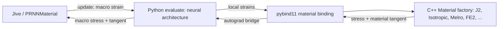

# Python architectures with native Jem/Jive materials

This alternative starts from `main` and embeds Python instead of fixing the
network topology in C++. `PRNNMaterial::update` calls Python `evaluate()`,
which calls the configured native `Material::update` through pybind11. The
same native constitutive implementation is used for Python training and Jive
inference. No Python J2 return mapper or C++ network port is needed.



The architecture examples in the request—decoder masks, nonlinear encoders,
and shared/transposed encoder-decoder parameters—belong entirely in Python.
The C++ driver knows a small model protocol and never reads checkpoint tensor
names or reconstructs the network. It calls a configurable Python loader, so
changing the architecture and its checkpoint format does not require rebuilding
the solver. C++ rebuilds are needed when adding a new native material.

## Build

For a container with the compiled solver, native extension and Python tools,
use the [Apptainer recipe](apptainer.md).

Use an isolated Python environment. Tested prerequisites are Python 3.12,
CPU PyTorch 2.8.0, pybind11 3.0.1, NumPy and pandas 2.2.3. The interpreter's
development headers and shared library are needed for embedding:

```sh
python -m pip install torch==2.8.0 --index-url https://download.pytorch.org/whl/cpu
python -m pip install -r python/requirements.txt

export JEMDIR=/path/to/jem-3.0
export JIVEDIR=/path/to/jive-3.0
# Configure/build the supplied toolkits first: Jem, then Jive.
(cd "$JEMDIR" && ./configure --with-threads && make -j4)
(cd "$JIVEDIR" && ./configure && make -j4)

# Standalone Python extension for training.
make -C python -j3 PYTHON="$(command -v python)"
export PYTHONPATH="$PWD/python${PYTHONPATH:+:$PYTHONPATH}"

# C++ driver with an embedded module exposing the same binding.
make -C src -j3 HEADLESS=1 PYTHON_BRIDGE=1 PYTHON="$(command -v python)"
```

Omit `HEADLESS=1` when Jem/Jive have OpenGL support. Omitting
`PYTHON_BRIDGE=1` preserves the original solver without a Python dependency.
Separate object directories and executable relinking support switching modes.
The selected interpreter, package directory, and library path are captured at
build time; rebuild if changing Python environments. Unlike the earlier branch,
this driver does not link the LibTorch C++ API directly.

## Training with C++ materials

The native binding selects any registered material using the same property
schema as Jive. It delegates construction, configuration, integration-point
allocation, updates and commit/cancel through `MaterialFactory` and `Material`:

```python
import torch
from _fe2_material import MaterialFactory
from pyprnn import PRNN

factory = MaterialFactory('''
material = {
  type = "J2"; rank = 2; state = "PlaneStress";
  young = 3130.; poisson = 0.37;
  yield = "64.80 - 33.60 * exp(x / -0.003407)";
  rmTolerance = 1.e-10; rmMaxIter = 100;
};
''')
model = PRNN(3, 3, 2, material_factory=factory).double()
prediction = model(strain_paths)  # CPU float64 [batch, time, components]
loss = (prediction - target_stresses).square().mean()
loss.backward()
```

`forward()` creates an independent native material context for each batch of
paths, starts it from virgin state, and commits between the time steps of that
training sequence. Calling training `forward()` never resets or advances an
existing online simulation context. The copied `pyprnn.utils` dataset/trainer
and `rnn.py` comparison architectures are included with upstream attribution
and the GPL-3.0 license; see `python/pyprnn/UPSTREAM.md`.

The binding lists the registered materials through `MaterialFactory.types()`.
J2 and Isotropic have been exercised in this branch. Melro and FE2 are
registered through the same factory and must be given their usual valid
configuration. FE2 additionally needs its mesh/micro-model configuration and
files. In an embedded run the binding receives Jive's actual `globdat`; the
standalone string factory starts with an empty one. Materials requiring
additional external context therefore need that context supplied through an
adapter. The bridge does not bypass a material's existing limitations (for
example, Melro plane-stress plasticity is not implemented).

## Autograd through history

The native material is opaque to PyTorch, so `MaterialUpdate` supplies a custom
first-order backward. For the current strain it uses the actual consistent
material tangent, `d stress / d strain`, at fixed accepted history. This lets
autograd differentiate arbitrary neural encoder/decoder operations and yields
the macro tangent for Newton iterations.

Using that tangent alone during training would lose the dependence of future
stress on earlier strains through plastic history. This implementation retains
the graph of committed **encoded strains** and computes the missing history
vector-Jacobian product by finite differences. Each perturbation replays the
accepted strain prefix through a fresh native material and evaluates the current
stress. These replicas never commit or reset the live online context.

This is a general fallback for deterministic, strain-driven constitutive laws
whose state can be reproduced by strain-history replay. It is **expensive**:
each past strain component requires two prefix replays. Long sequences and
large batches will need material-specific state Jacobians/VJPs or an explicit
state interface for practical training throughput. Time-, rate- or externally
driven models also require replaying those inputs; strain-only replay does not
supply them automatically. Native constitutive parameters and second-order
material derivatives are not differentiated by this prototype.

## Online lifecycle and model protocol

`evaluate(strain)` creates its native context only on the first online call
(t=0). Every later call computes a **trial** using the last accepted native
history. It neither recreates the material nor commits it. Jive COMMIT calls
Python `commit()`, which forwards to the native material; Jive CANCEL similarly
calls `cancel()`. `reset()` is an explicit start of a new problem.

The loader named by the Jive configuration must return a CPU float64 model
implementing:

| Method | Contract |
| --- | --- |
| `evaluate(strain)` | Return a differentiable macro stress vector; stage trial state only. |
| `commit()` | Accept the staged trial, once. |
| `cancel()` | Discard the trial and retain accepted history. |
| `observe(strain)` | Return stress without replacing any pending solver trial. |

For the supplied model, stress-only output temporarily evaluates its requested
strain, then restores the pending Newton candidate or cancels the observation.
Neural architectures with their own recurrent state must apply the same
trial/accepted distinction to that state. This is a model protocol, not a claim
that every arbitrary Python module can be called unchanged as an online material.

The loader signature is `load_model(weights, material_factory)`. The factory
is callable with a material-point count. The default loader in
`pyprnn.checkpoint` loads upstream Trainer/state-dict checkpoints. A custom
loader can construct another architecture and load its weights with no C++
changes. Material properties and strain preprocessing must match training;
the default architecture uses raw strains and unscaled stress outputs.

Example Jive configuration:

```text
material = {
  type = "PRNN"; rank = 2; state = "PlaneStress";
  weights = "checkpoint.pth";
  module = "pyprnn.checkpoint"; loader = "load_model";
  // Optional additional directory containing your own loader module:
  // pythonPath = "/path/to/architecture/modules";
  material = {
    type = "J2"; rank = 2; state = "PlaneStress";
    young = 3130.; poisson = 0.37;
    yield = "64.80 - 33.60 * exp(x / -0.003407)";
    rmMaxIter = 100;
  };
};
```

Use a nonsymmetric global matrix: a learned encoder/decoder need not preserve
material-tangent symmetry. The default loader scripts the pure neural layers;
Python owns the material context and sequence/online control flow.

## JIT and performance limits

The two-way callback works, but **the whole framework is not a single JIT
graph**. TorchScript can compile the neural submodules (`script_neural_layers`);
it cannot directly compile arbitrary pybind11 objects, Python history lists,
or this custom Python autograd callback. Changing a neural architecture stays
in Python, but full graph compilation would require registered Torch custom
operators and an exportable material-state representation.

Python calls acquire the GIL. A dedicated Jem-managed worker executes native
material operations, which also makes calls from Python/PyTorch worker threads
safe for Jem's allocator. Constitutive callbacks are serialized in this
prototype. Four Jive workers were tested; serial element assembly avoids GIL
contention and is the example default. Set `OMP_NUM_THREADS=1 MKL_NUM_THREADS=1`
to avoid nested BLAS pools. This version favors architecture experimentation;
it has substantially more online overhead than the fixed C++/LibTorch version.
JIT on the neural layers does not remove that callback overhead.
For standalone Python, import `_fe2_material` on the main thread before
starting worker calls. This initializes Jem's process runtime and main-thread
allocator safely; a first import from a worker raises `ImportError`.

## Validation and example

```sh
PYTHONPATH=python OMP_NUM_THREADS=1 MKL_NUM_THREADS=1 \
  python -m unittest discover -s tests -p 'test_python_bridge.py' -v
bash examples/plate_incs/python_prnn/go.sh /path/to/prnn_gp_80_0.pth
```

Nine tests cover the factory, elastic/J2 responses, full-sequence gradcheck,
an encoder-parameter gradient through prior plastic loading, online tangents,
commit/cancel and observation isolation, training-context isolation, scripting,
nonlinear encoder substitution, native calls from ordinary Python workers,
and cold-runtime initialization/shutdown in separate Python processes.
An external loader containing a scripted nonlinear encoder also completed
three embedded Jive increments, using the `module`/`pythonPath` configuration
without changing the C++ binary.

The example uses `fe2_j2` geometry/loading with the public pyprnn checkpoint's
**plane-stress training material**, not the original plane-strain inclusion
microstructure. Its 55 accepted increments match the previous implementation's
reactions. Matching the original FE2 micromodel requires corresponding pretrained
weights. No dataset training was performed and weights are not committed.
